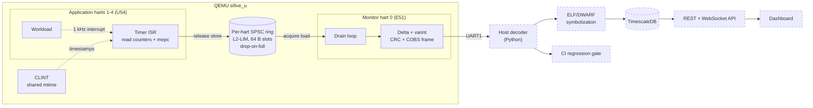

# HartWatch-Multicore-RISC-V-Telemetry-Firmware
Because measuring a CPU shouldn't slow it down. A RISC-V monitor core (E51) does the boring parts so the application cores (U54) can keep working.


# HartWatch

**Watching CPUs without slowing them down.** Low-overhead performance telemetry for a multicore RISC-V target, built bare-metal in C and run on QEMU's `sifive_u` machine (1x E51 monitor core + 4x U54 application cores).

## The problem

RISC-V performance counters (`mcycle`, `minstret`, `mhpmcounter*`) are **hart-local**: a core can only read its own. So every sample is paid for by the core being measured, and measuring it changes what you measure.

## The idea

The E51 is a small monitor core that runs no application work. HartWatch keeps the cost on the application cores to a counter snapshot and moves everything else to the E51:

- **U54 harts:** a timer interrupt reads the counters and `mepc` and writes one 64-byte record into a private ring buffer.
- **E51 hart:** drains the rings, encodes and frames the data, and sends it out over a UART.
- **Host (planned):** decodes the stream and maps `mepc` to function names.

Rings are single-producer/single-consumer with **drop-on-full**: the sampled core never blocks, and dropped samples are counted and reported rather than hidden.

## Architecture



Dashed boxes are **planned**; see [Status](#status).

## The sample record

One record is exactly one 64-byte cache line.

```c
typedef struct {
    uint32_t seq;        /*  0: per-hart sequence number             */
    uint8_t  hart;       /*  4                                       */
    uint8_t  flags;      /*  5                                       */
    uint16_t check;      /*  6: checksum used by the stress test     */
    uint64_t mtime;      /*  8: shared timeline, read in the ISR     */
    uint64_t mcycle;     /* 16                                       */
    uint64_t minstret;   /* 24                                       */
    uint64_t hpm[3];     /* 32: DTLB read, DTLB write, ITLB miss     */
    uint64_t mepc;       /* 56: interrupted instruction              */
} sample_t;              /* 64 bytes                                 */
```

Raw ring rate for 4 harts (calculated, not measured): 25.6 KB/s at 100 Hz, 256 KB/s at 1 kHz, 5.12 MB/s at 20 kHz.

## Status

| Day | Milestone | State |
| --- | --- | --- |
| 1 | Toolchain, multi-hart boot, UART, 1 kHz timer interrupts | done |
| 2 | Counter investigation, `hpm_backend`, sampling ISR, host unit tests | counter investigation done; rest in progress |
| 3 | Lock-free rings, E51 drain, encoding and framing, host decoder | planned |
| 4 | Collector, schema, symbolization | planned |
| 5 | API, tests, dashboard, containers | planned |
| 6 | Benchmarks, overhead sweep, CI gate | planned |
| 7 | Design doc, demo, v1.0 | planned |

## What has been measured so far

All results are from QEMU 8.2.2 with `-icount shift=0,sleep=off` (deterministic virtual time, 1 instruction = 1 ns) unless noted.

- **Timer ticks:** with `-icount`, every tick gap was 999-1001 us with zero late ticks. Without it, tick spacing varied by milliseconds from run to run.
- **IPC is flat on QEMU:** 1.000 for every workload under `-icount`, 0.994-1.000 without. An IPC-based regression gate cannot work here, so the gate uses other metrics (below).
- **`minstret` is exact:** within 16 instructions of the true count on 35-48 million.
- **DTLB misses separate workloads cleanly:**

| Workload | DTLB read miss | DTLB write miss |
| --- | --- | --- |
| Arithmetic / branch-heavy | 0 | 0 |
| Load, stride 64 B | 78,125 | 0 |
| Load, stride 4 KiB + 64 B | 5,000,000 | 0 |
| Store, stride 64 B | 0 | 78,125 |
| Store, stride 4 KiB + 64 B | 0 | 5,000,000 |

The ITLB-miss counter barely moves on these workloads and is unproven.

## QEMU vs. real silicon

| Counter | QEMU | FU540 silicon |
| --- | --- | --- |
| `mcycle`, `minstret` | present; cycles equal instructions under `-icount` | real |
| DTLB / ITLB miss events | counted from QEMU's software TLB, not the U54's | real, different selector encoding |
| Branch mispredict, I-cache miss | not measured here | real; needs SiFive raw event bits |

Counter access sits behind an `hpm_backend` interface (`hpm_qemu`, `hpm_sifive`). Real IPC lives in `hpm_sifive` and is **untested on hardware**.

## CI gate (design)

Because IPC is flat on QEMU, the gate fails a change when **instructions retired** (`minstret`) or **DTLB misses per thousand instructions** rise more than a configurable threshold (default 3%) against a stored baseline. Under `-icount` results are deterministic, so a plain threshold is used. Mann-Whitney U is reserved for a separate wall-clock job, which measures QEMU host runtime and not target performance.

## Quick start

```bash
# Ubuntu 24.04 / WSL2
sudo apt install -y make git python3 gcc-riscv64-unknown-elf \
    binutils-riscv64-unknown-elf qemu-system-misc gdb-multiarch device-tree-compiler

scripts/check_env.sh   # verify the toolchain
make test              # boot 5 harts in QEMU, expect PASS
```

Other commands: `make run`, `make debug` + `make gdb`, `make disasm`, `make dtb`. See [SETUP.md](SETUP.md) for details.

**Debugging note:** GDB controls hart 0 only with this QEMU; inspect the U54s through the QEMU monitor (`cpu N`, `info registers`).

## Repository layout

```
fw/boot.S        first instructions every hart runs; trap entry
fw/linker.ld     memory layout
fw/src/          C firmware
host/            decoder and collector (planned)
scripts/         environment check, test runner
docs/            walkthroughs, design notes, engineering log
```

## Non-goals

No custom RTOS, no Linux/OpenSBI port, no hand-rolled storage engine, no authentication, no RTL.

## Documentation

- [`docs/DAY1.md`](docs/DAY1.md) -- bring-up explained from zero
- [`docs/ENGINEERING_LOG.md`](docs/ENGINEERING_LOG.md) -- what was observed, tested and decided
